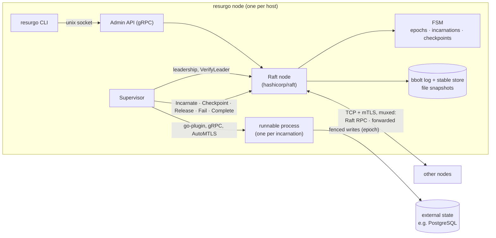
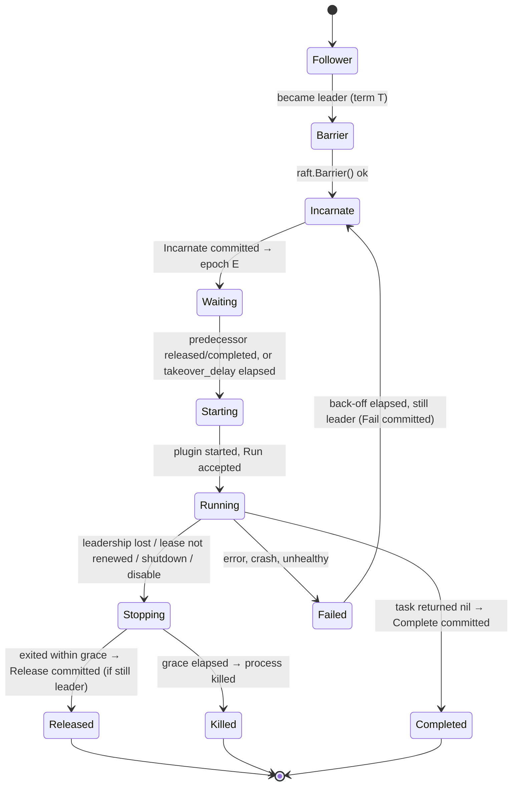

# Architectural & Technical Specification: `resurgo`, a runnable on the leader of a Raft cluster, run again on every new leader

- **Document Version:** `0.3.10` (2026-11-27): raft-wal the default log store for new nodes (`raft.log_store`, FW-2, ADR-1); `0.3.9` (2026-11-27): a node with no state probes the voters before bootstrapping (FR-1, ADR-3); `0.3.8` (2026-11-27): example runnables and packaging as built (§14, C6); `0.3.7` (2026-11-27): admin API, metrics and store commands as built in C5, opt-in remote admin endpoint (SEC-11, T-14, R-7); `0.3.6` (2026-11-26): plugin protocol as built (§8.2); `0.3.5` (2026-11-26): OI-12 decided; `0.3.4` (2026-11-26): member identities recorded through the log (`SetPeer`, `RemovePeer`); `0.3.3` (2026-11-26): SEC-2 and `tls.peers` as built in C2; `0.3.2` (2026-11-26): command details settled in C1 (§9.2); `0.3.1` (2026-11-26): spike results (§12.1); `0.3.0` (2026-11-25): store engine `mattn/go-sqlite3` (static, musl), operator writes, WAN profile (§8.7), MIT; OI-1, OI-6, OI-7 decided
- **Status:** Approved for implementation (2026-11-26, `AGENTS.md` rule 1)
- **Target Stack:** Go 1.27.4+, `github.com/hashicorp/raft` (v1.8.x, pinned), `github.com/hashicorp/raft-wal` (v0.5.x, the default log store) and `github.com/hashicorp/raft-boltdb/v2` (on `go.etcd.io/bbolt` v1.5.x, required directly), `github.com/hashicorp/go-plugin` (v1.8.x, gRPC), `github.com/mattn/go-sqlite3` (the store; cgo), Protocol Buffers, `github.com/jessevdk/go-flags`, `log/slog`; Linux amd64/arm64, statically linked (musl)
- **Purpose:** Requirements, decisions, invariants, threat model, acceptance scenarios and open issues for Spec-Driven Development

---

## 0. Document Conventions

### 0.1 Normative language
The key words **MUST**, **MUST NOT**, **REQUIRED**, **SHALL**, **SHOULD**, **SHOULD NOT**, **MAY** are to be interpreted as described in RFC 2119 / RFC 8174. Sections and blocks marked *(illustrative)* show one possible shape (a sketch of code, a configuration example); everything else is normative.

### 0.2 Identifier scheme
| Prefix | Meaning |
| :--- | :--- |
| `FR-nn`, `NFR-nn` | Functional and non-functional requirement (§5, §6) |
| `SEC-nn` | Security requirement (§11) |
| `ADR-nn` | Architectural decision (§12) |
| `INV-nn` | System invariant (MUST hold at all times; each MUST have at least one automated test; §13) |
| `T-nn`, `R-nn` | Threat and accepted residual risk (§11) |
| `AC-nn` | Acceptance scenario (§14) |
| `EXT-nn` | External assumption about a dependency, verified by the spike (§12.1) |
| `OI-nn` | Open issue to decide before implementing the affected component (§15) |
| `FW-nn` | Future work: recorded for later, not part of this version (`resurgo-backlog.md`) |

## 1. Problem statement

Some work must run in exactly one place at a time: a scheduler, a
reconciler, a poller of an external system, a singleton consumer, a
lease holder. Running it on one fixed machine makes that machine a single
point of failure; running it everywhere makes it run more than once.

`resurgo` (Latin, *I rise again*) runs such work, packaged as a plugin
called a **runnable**, on the **leader** of a small Raft cluster of
`resurgo` nodes, and nowhere else. When leadership moves, because the leader
failed, was partitioned away, or was shut down, the runnable is stopped on
the old leader (if it is still alive) and started again on the new one: a
new **incarnation**. Each incarnation receives a **fencing epoch**, strictly
greater than every earlier one, and the last **checkpoint** that an earlier
incarnation committed.

Runnables are *stateless* (they keep nothing between incarnations) or
*stateful*. A stateful runnable keeps its state in its own **store**, a
SQLite database replicated through the Raft log and fenced by the epoch
(`resurgo-store.md`), or in an external system (for example a PostgreSQL
cluster) that it fences with the epoch itself. A runnable MAY also commit a
small **checkpoint**, so that the next incarnation can restart from where
the last one left off. Apart from the stores, the Raft state machine holds
only the epochs and the current incarnations.

## 2. Goals

- G1. **Leader-bound execution:** a configured runnable runs on the current
  leader only, and is started again on every new leader.
- G2. **Fencing:** every incarnation has a unique epoch, strictly greater
  than its predecessors', committed through Raft before it starts; stale
  incarnations cannot commit checkpoints, and runnables can fence external
  systems with the same number.
- G3. **Bounded overlap:** the window in which two incarnations may both be
  running is bounded by configuration, and is zero on a planned handover.
- G4. **Durable checkpoints:** a checkpoint acknowledged to a runnable is
  never lost and is seen by every later incarnation.
- G5. **Generic and isolated:** runnables are separate binaries behind one
  standard interface (`hashicorp/go-plugin`), written against a small public
  SDK, and run in their own processes, so that a stop can always be enforced.
- G6. **Low operational footprint:** one static Go binary per node, no
  external coordination service, 3 or 5 nodes.

## 3. Non-goals (v1)

- A general-purpose scheduler: no placement on followers, no bin packing,
  no constraints beyond "on the leader".
- Exactly-once side effects: `resurgo` bounds overlap and provides the
  fencing epoch; side effects outside fenced systems may repeat (§8.5).
- A general-purpose replicated database: a runnable's store serves that
  runnable only, is bounded in size and work, and is not reachable by other
  clients (`resurgo-store.md`); bulk state lives outside.
- Uploading or distributing runnable binaries through the cluster: binaries
  are installed on every node by packaging or configuration management.
- Windows, macOS and the BSDs.
- Running inside Kubernetes as the primary target (it is possible; leader
  election there is usually done with Lease objects instead).

## 4. Glossary

| Term | Meaning |
| :--- | :--- |
| Node | One `resurgo serve` process, a Raft server (voter or non-voter). |
| Leader | The Raft leader; the only node that runs runnables. |
| Runnable | A plugin binary implementing the runnable interface (§8), plus its node-local configuration, identified by a name unique in the cluster. |
| Incarnation | One execution of a runnable: one plugin process, from its start on a leader to its stop. |
| Epoch | A cluster-wide counter in the FSM, incremented for every incarnation of every runnable; an incarnation's epoch is its fencing token. |
| Checkpoint | Opaque bytes a runnable commits through Raft, with a per-runnable sequence number and the epoch that wrote it. |
| Release | The record, committed by the leader, that an incarnation stopped cleanly; a released predecessor needs no takeover delay. |
| Supervisor | The component of a node that turns leadership changes into incarnations. |
| Lease (runnable lease) | The time until which the plugin process may act, renewed by the host's heartbeats (§8.3). |
| Takeover delay | The wait of a new leader before starting a runnable whose predecessor was not released (§8.4). |
| Service / task | The two kinds of runnable: a service runs until stopped; a task runs to completion once (FR-7). |

## 5. Functional requirements

### Cluster
- **FR-1 (static bootstrap)** A node's configuration lists the initial
  voters (ID and address). A node with no Raft state MUST bootstrap the
  cluster with exactly that list; all initial voters MUST list the same
  voters (EXT-2). A node with existing state ignores the list.
  As built (2026-11-27): before bootstrapping, a node with no state asks
  the other configured voters over the cluster port (a `P` probe stream)
  whether they have state; if any has, it does not bootstrap and waits for
  the leader, so that a rebuilt node never writes a first entry that
  differs from the cluster's. A majority of nodes without state, the
  others unreachable, cannot tell a lost cluster from a new one and
  bootstraps: never wipe a majority while the others are down.
- **FR-2 (membership)** Voters and non-voters MUST be addable and removable
  at runtime (`resurgo member add|remove`); the change is executed by the
  leader. `member add` takes the member's certificate identity
  (`--identity`), recorded through the log so that every node accepts the
  member without a restart (§10.1). Removing the current leader MUST first transfer leadership.
- **FR-3 (leadership transfer)** An operator MUST be able to move
  leadership to a named node or to any other voter (`resurgo leader
  transfer [--to ID]`); this is a planned handover (FR-12).

### Runnables
- **FR-4 (leader only)** A runnable MUST be started only on the leader, and
  only after its incarnation is committed (INV-2).
- **FR-5 (re-execution)** On every change of leader, every enabled and not
  completed runnable MUST be started on the new leader as a new incarnation.
  The same node regaining leadership in a later term is a change of leader.
- **FR-6 (several runnables)** A cluster usually runs one runnable, but
  MAY run several, each with its own name, binary, configuration, store,
  checkpoint and restart policy; all of them run on the leader.
- **FR-7 (kinds)** A runnable declares its kind:
  - *service*: runs until stopped; an exit, with or without error, is a
    failure handled by FR-8.
  - *task*: runs to completion once per cluster; a successful return MUST
    be committed as completion, and a completed task MUST NOT be started
    again until an operator resets it (`resurgo runnable reset`). An error
    is a failure handled by FR-8 (OI-2).
- **FR-8 (failures)** A failed incarnation (error, crash, failed health
  check, failure to start) MUST be restarted on the same leader as a new
  incarnation, after an exponential back-off (`restart.initial`,
  `restart.max`, with jitter). After `restart.handover_after` consecutive
  failures on the leader, the leader SHOULD transfer leadership to the
  voter with the fewest recorded recent failures of that runnable, unless
  every voter has failed recently, in which case it keeps backing off
  (OI-5). Failures are committed (`Fail`), so that the choice survives
  leader changes.
- **FR-9 (checkpoints)** A running incarnation MAY commit a checkpoint: up
  to `checkpoint.max_size` bytes (default 256 KiB, at most 1 MiB), at most
  once per `checkpoint.min_interval` (default 1 s; a faster caller is held
  back, not refused). `Checkpoint` MUST return only after the entry is
  committed by a quorum and applied on the leader, with its sequence number;
  it MUST fail with `ErrFenced` when the incarnation is no longer current.
  The latest checkpoint replaces the previous one. Checkpoints are stored
  in the runnable's store (STO-12).
- **FR-17 (store)** Every runnable MUST have its own replicated, fenced SQL
  store, as specified in `resurgo-store.md`; the runnable migrates its own
  schema at the start of each incarnation (STO-13).
- **FR-10 (resume)** Every incarnation MUST receive the latest committed
  checkpoint of its runnable (or none), its epoch, the Raft term, the node
  ID, the cluster name and its configuration (INV-4).
- **FR-11 (stop on loss)** When the leader loses leadership, or cannot
  confirm it (§8.3), it MUST cancel every incarnation at once, and kill
  each plugin process that has not exited within its `stop_grace`
  (default 2 s).
- **FR-12 (planned handover)** On `SIGTERM`, on `leader transfer` and on
  removal, the leader MUST stop every incarnation within its
  `shutdown_grace` (default 30 s), commit `Release` for each one that
  stopped, and only then transfer leadership. The new leader MUST NOT wait
  the takeover delay for a released predecessor.
- **FR-13 (takeover delay)** A new leader MUST NOT start an incarnation
  whose predecessor is neither released nor completed before
  `takeover_delay` has elapsed since it became leader (§8.4).
- **FR-14 (administration)** An operator MUST be able to enable, disable,
  restart and reset a runnable, show its state (current incarnation, epoch,
  checkpoint sequence, size and age, failures, completion) and clear its
  checkpoint. Disabling stops it and is committed, so it survives leader
  changes.
- **FR-15 (configuration drift)** Runnable configuration is node-local
  (ADR-6). Each incarnation MUST record the SHA-256 digests of its binary
  and its configuration; `runnable show` MUST show them, and a node MUST
  report when its digests differ from those of the current incarnation.
- **FR-16 (validation)** At start, a node MUST check every configured
  runnable: the binary exists and matches its pinned digest, the plugin
  answers `Describe` with the configured name and a supported protocol,
  and `Validate` accepts the configuration. A node with an invalid runnable
  MUST still join the cluster and MUST report the error at `error` level
  and in `runnable show`; whether it also gives leadership away is OI-11.

## 6. Non-functional requirements

- **NFR-1 (cluster size)** 3 or 5 voters (any odd number works); optional
  non-voters. A cluster tolerates the loss of a minority of voters.
- **NFR-2 (consistency)** CP: a runnable runs only where a quorum
  recognises the leader; a minority partition runs nothing.
- **NFR-3 (failover time)** With the default timings on a LAN (§8.6):
  unplanned failover (leader crash or partition) starts the new incarnation
  within 10 s at p99; a planned handover within `shutdown_grace` + 2 s.
  With the WAN profile (§8.7): within 15 s at p99, and `shutdown_grace` +
  3 s.
- **NFR-4 (overlap)** Without process pauses, the time in which two
  incarnations of the same runnable act at once is zero when the timings
  satisfy §8.4; with pauses, stale incarnations are fenced (INV-3, §8.5).
- **NFR-5 (footprint)** A node idles below 50 MiB RSS and 1 % of a core,
  plugin processes excluded.
- **NFR-6 (portability)** Linux amd64/arm64, one statically linked binary;
  cgo only for SQLite, built against musl (`resurgo-store.md` §4.1);
  runnables and the SDK need no cgo. Tier 1:
  LXD and OpenStack VMs on Ubuntu 24.04 LTS or later and Rocky/Alma, under
  systemd.
- **NFR-7 (observability)** Structured logs (`slog`, with `node_id`,
  `runnable`, `epoch`, `term`), Prometheus metrics (§10.3), and the state
  shown by the CLI.
- **NFR-8 (determinism)** The FSM's `Apply`, `Snapshot` and `Restore` use
  no clock and no randomness, and no I/O beyond the snapshot sink and the
  runnables' store files; store batches are made deterministic by STO-4 and
  STO-5 (INV-7, INV-S-1).

## 7. Architecture

### 7.1 Components



- **Raft node** (`internal/raftnode`): `hashicorp/raft` with the bbolt
  stores and a file snapshot store under `data_dir`, and a stream layer that
  carries the Raft RPCs and the forwarded admin calls over one mTLS port
  (ADR-3).
- **FSM** (`internal/fsm`): the state of §9, protobuf-encoded commands.
- **Supervisor** (`internal/supervisor`): observes leadership, runs one
  *incarnation controller* per runnable on the leader, and nothing on a
  follower.
- **Runnable SDK** (`pkg/runnable`): the Go interface (§8.1), the plugin
  server (`Serve`) used in a runnable's `main`, the loader used by the
  supervisor, an in-process loader for tests, and the conformance kit.
- **Admin API** (`internal/admin`): gRPC on a local unix socket; mutations
  are executed by the leader, forwarded over the cluster port when the
  local node is a follower.

### 7.2 Life of an incarnation on the leader



Per runnable, on becoming leader:

1. `raft.Barrier()`: every entry committed by earlier leaders is applied to
   the local FSM, so the leader sees the latest checkpoint (INV-4).
2. `Apply(Incarnate{runnable, node, binary_sha256, config_sha256, at})`:
   the FSM assigns `epoch = ++epoch_counter` and makes it the runnable's
   current incarnation. On error (for example `ErrLeadershipLost`) nothing
   starts.
3. Wait per FR-13.
4. Start a fresh plugin process (ADR-4), open the `Run` stream, send
   `Start` with the incarnation and the checkpoint, and start heartbeats
   (§8.3).
5. Serve `Checkpoint` and `Status` requests until the stream ends or the
   incarnation is stopped.

Incarnations of different runnables are independent: one failing does not
restart the others.

## 8. The runnable interface and protocol

### 8.1 Go interface (illustrative)

```go
package runnable

// Kind is how a runnable ends (FR-7).
type Kind int

const (
	Service Kind = iota // runs until stopped
	Task                // runs to completion once per cluster
)

type Description struct {
	Name         string // MUST match the name in the node's configuration
	Version      string // the runnable's own version
	Kind         Kind
	Stateful     bool   // keeps state outside: fences it with the epoch (§8.5)
	ConfigSchema []byte // optional JSON Schema of its configuration
}

type Checkpoint struct {
	Seq         uint64    // per runnable, strictly increasing
	Epoch       uint64    // the incarnation that wrote it
	Data        []byte
	CommittedAt time.Time // the leader's clock: informational only
}

type Incarnation struct {
	Runnable   string
	Epoch      uint64      // the fencing token
	Term       uint64      // the Raft term of the leader that started it
	Node       string
	Cluster    string
	Config     []byte      // the node-local configuration, as JSON
	Checkpoint *Checkpoint // nil: there is none
}

// Host is the node, as seen by a running incarnation.
type Host interface {
	// Checkpoint replicates data through Raft; it returns once a quorum has
	// committed it (FR-9), or ErrFenced, after which Run MUST return.
	Checkpoint(ctx context.Context, data []byte) (seq uint64, err error)
	// Status reports health and progress, shown by "runnable show";
	// unhealthy for longer than health.timeout fails the incarnation.
	Status(ctx context.Context, healthy bool, detail string) error
	// Store is the runnable's replicated SQL database (resurgo-store.md).
	Store() Store
}

type Runnable interface {
	Describe() Description
	// Validate checks a configuration without side effects (FR-16).
	Validate(ctx context.Context, config []byte) error
	// Run does the work. ctx is cancelled when the incarnation must stop
	// (leadership lost, lease expired, shutdown, disable); Run MUST return
	// within the stop grace after that. A nil return completes a task;
	// for a service any return is a failure (FR-7).
	Run(ctx context.Context, inc Incarnation, host Host) error
}

var ErrFenced = errors.New("runnable: fenced: a newer incarnation exists")
```

A runnable's `main` is `runnable.Serve(impl)`. The SDK, not the runnable,
implements the lease of §8.3: the `ctx` passed to `Run` is cancelled by the
SDK when the lease expires, even if the host is unreachable.

### 8.2 Plugin protocol

`hashicorp/go-plugin`, gRPC only, AutoMTLS on, handshake
`RESURGO_RUNNABLE` / protocol version 1 (a plugin of another protocol is
refused before the first call). One service *(illustrative)*:

```proto
service Runnable {
  rpc Describe(DescribeRequest) returns (Description);
  rpc Validate(ValidateRequest) returns (ValidateResponse);
  // One bidirectional stream per incarnation: the host sends Start, then
  // Heartbeats and answers; the runnable sends requests and its exit.
  rpc Run(stream HostMessage) returns (stream RunnableMessage);
}

message HostMessage {
  oneof msg {
    Start start = 1;                    // the Incarnation, once, first
    Heartbeat heartbeat = 2;            // lease renewal (§8.3)
    CheckpointResult checkpoint_result = 3;
    Stop stop = 4;                      // cooperative stop, with a reason
  }
}
message Heartbeat { int64 valid_until_boottime_ns = 1; }

message RunnableMessage {
  oneof msg {
    CheckpointRequest checkpoint = 1;   // id, data
    StatusReport status = 2;            // healthy, detail
    Exit exit = 3;                      // completed | error (class, message)
    StoreExec exec = 4;                 // id, batch (resurgo-store.md)
    StoreQuery query = 5;               // id, sql, args; rows stream back
  }
}
```

Requests on the stream carry an ID; the host answers each with a result of
the same ID. The stream ending without `Exit` is a crash. As built (C3,
`proto/runnable/v1`): `Start` also carries the first lease
(`valid_until_boottime_ns`), so that `Run` never runs unleased; results
are `CheckpointResult`, `StatusResult`, `ExecResult` and `QueryResult`
(the query's rows in one message, bounded by `store.max_result`); errors
say whether they are a fencing or a rolled-back batch. The plugin's
stderr is captured into the node's log with `runnable` and `epoch`.

### 8.3 Leadership confirmation and the runnable lease

Raft's leader steps down after `leader_lease_timeout` without contact with
a quorum (EXT-3), but a stop that depends only on the node is not enough:
the runnable is a separate process, which keeps running while the node is
paused (GC, `SIGSTOP`, a frozen VM). Therefore:

1. While an incarnation runs, the supervisor calls `raft.VerifyLeader()`
   every `lease.renew_interval` (default 250 ms). Let `t0` be the
   `CLOCK_BOOTTIME` reading taken *before* the call. On success it sends
   `Heartbeat{valid_until = t0 + lease.duration}` (default 750 ms).
2. The SDK in the plugin process cancels `Run`'s context as soon as its own
   `CLOCK_BOOTTIME` passes the latest `valid_until` it received. Both
   processes read the same kernel clock (EXT-6), so a node paused after
   verifying cannot extend the lease.
3. A failed `VerifyLeader`, or `LeaderCh` reporting loss, makes the
   supervisor send `Stop` and cancel at once (FR-11).

Followers that acknowledged the verification at or after `t0` will not
start an election, nor vote for another candidate, before
`t0 + heartbeat_timeout` by their own clocks (EXT-9); every quorum that
could elect a new leader contains one of them, so,
with `lease.duration < heartbeat_timeout` and rate drift bounded, the lease
of an incarnation expires before a new leader can exist. The configuration
MUST be refused when `lease.duration >= heartbeat_timeout`.

### 8.4 Takeover delay

An unreleased predecessor stops acting at the latest at
`t0 + lease.duration + stop_grace` (cancelled at lease expiry, then given
its grace). A new leader cannot exist before `t0 + heartbeat_timeout`.
Starting the successor `takeover_delay` after becoming leader therefore
leaves no overlap when

```
takeover_delay >= lease.duration + stop_grace - heartbeat_timeout + drift_margin
```

`takeover_delay: auto` (the default) computes it with `drift_margin` =
500 ms: 2.25 s with the defaults. A runnable that fences everything it
touches (§8.5) MAY set `takeover_delay: 0s` to fail over faster. A released
or completed predecessor needs no delay (FR-12).

The formula assumes that the predecessor honours its context within
`stop_grace` and that its process is not itself paused; neither can be
enforced from outside a paused process, which is what fencing is for.

### 8.5 Fencing external state (stateful runnables)

The epoch protects the FSM by itself (INV-3). For external state, a
stateful runnable MUST make every write conditional on its epoch being the
newest the store has seen. For PostgreSQL *(illustrative)*:

```sql
CREATE TABLE resurgo_fence (runnable text PRIMARY KEY, epoch bigint NOT NULL);

-- at start of the incarnation: claim the fence, or find out it is stale
INSERT INTO resurgo_fence VALUES ($1, $2)
  ON CONFLICT (runnable) DO UPDATE SET epoch = EXCLUDED.epoch
  WHERE resurgo_fence.epoch < EXCLUDED.epoch;      -- 0 rows: fenced, return

-- in every transaction that writes state
SELECT epoch FROM resurgo_fence WHERE runnable = $1 FOR SHARE;  -- MUST equal $2
-- ... the writes ...
COMMIT;
```

The claim's row lock waits for the predecessor's open transactions, and
after the claim every predecessor transaction fails its check, so the
store serialises the two incarnations whatever their timing. A helper in
the SDK is future work (FW-10, OI-12). Side
effects in systems that cannot check an epoch (an e-mail, a call to an
external API) may happen twice during an overlap; runnables that need
them exactly once must make them idempotent at the receiver.

### 8.6 Timings

| Setting | Default | Notes |
| :--- | :--- | :--- |
| `raft.heartbeat_timeout` | 1 s | hashicorp/raft default; WAN deployments raise it (OI-7) |
| `raft.election_timeout` | 1 s | |
| `raft.leader_lease_timeout` | 500 ms | MUST be < `heartbeat_timeout` |
| `lease.renew_interval` | 250 ms | MUST be ≤ `lease.duration` / 3 |
| `lease.duration` | 750 ms | MUST be < `heartbeat_timeout` |
| `stop_grace` | 2 s | per runnable, unplanned stop |
| `shutdown_grace` | 30 s | per runnable, planned handover |
| `takeover_delay` | `auto` (2.25 s) | per runnable, §8.4 |
| `restart.initial` / `restart.max` | 1 s / 2 min | exponential, jittered |
| `restart.handover_after` | 5 | consecutive failures, FR-8 |
| `checkpoint.max_size` | 256 KiB | hard limit 1 MiB |
| `checkpoint.min_interval` | 1 s | |

Expected unplanned failover with the defaults: election 1–2 s, barrier and
`Incarnate` a few round trips, takeover delay 2.25 s, plugin start
< 1 s: about 5 s, within NFR-3.

### 8.7 WAN profile (three regions)

The defaults of §8.6 target a LAN. Voters MAY also be spread over three
regions (round-trip times of about 30 ± 10 ms); `raft.profile: wan` then
sets:

| Setting | LAN | WAN |
| :--- | :--- | :--- |
| `raft.heartbeat_timeout` / `election_timeout` | 1 s / 1 s | 2 s / 2 s |
| `raft.leader_lease_timeout` | 500 ms | 1 s |
| `lease.duration` / `lease.renew_interval` | 750 ms / 250 ms | 1.5 s / 400 ms |
| `takeover_delay: auto` | 2.25 s | 2 s |

Consequences, measured in the lab (AC-16):
- unplanned failover about 5 to 8 s (election 2–4 s, `Barrier` and
  `Incarnate` a few round trips, takeover delay, plugin start);
- every store batch and checkpoint costs at least one round trip to the
  nearest other region: a runnable that writes one batch at a time gets
  about 25 batches/s, so the SDK issues batches concurrently where order
  allows (Raft pipelines them), and reads stay local;
- placement: 3 voters, one per region (a region loss leaves a quorum), or
  5 as 2 + 2 + 1. Which region leads is not controlled; a preferred-leader
  policy is FW-9.

The profile is a starting point; the lab's measurements decide its final
values.

## 9. The state machine

### 9.1 State

```
State
  format_version   uint32
  epoch_counter    uint64                     // last epoch handed out
  runnables        map[name] Runnable

Runnable
  current          Incarnation?               // epoch, term, node, started_at,
                                              // binary_sha256, config_sha256
  released         bool                       // current stopped cleanly
  checkpoint       Checkpoint?                // seq, epoch, committed_at (data in the store)
  store_limits     StoreLimits                // from Incarnate (STO-8)
  completed        Completion?                // epoch, at (tasks)
  disabled         bool
  failures         map[node] FailureRecord    // consecutive, last_at, last_reason
```

### 9.2 Commands

Every log entry is one protobuf `Command` with a type and a format version;
the FSM refuses unknown types and versions with an error result (never a
panic), so mixed versions during a rolling upgrade fail safe (OI-10).
Timestamps (`at`) are set by the leader; the FSM copies them and never
reads a clock.

| Command | Effect | Refused when |
| :--- | :--- | :--- |
| `StoreBatch{runnable, epoch, statements, at}` | applied to the runnable's database in one transaction (`resurgo-store.md`) | stale epoch (`ErrFenced`); STO-4, STO-7, STO-8 |
| `Incarnate{runnable, node, digests, store_limits, at}` | `epoch = ++epoch_counter`; `current = {epoch, log.Term, node, …}`; `released = false`; returns `epoch` | runnable disabled or completed |
| `Checkpoint{runnable, epoch, data, at}` | `checkpoint = {seq+1, epoch, data, at}`; returns `seq` | `epoch != current.epoch`, or released (`ErrFenced`); `len(data) > 1 MiB` |
| `Release{runnable, epoch, at}` | `released = true` | `epoch != current.epoch` |
| `Complete{runnable, epoch, at}` | `completed = {epoch, at}`, `released = true` | `epoch != current.epoch` |
| `Fail{runnable, epoch, node, reason, at}` | `failures[node].consecutive++`; a successful `Release` or `Checkpoint` resets the node's count | `epoch != current.epoch` |
| `SetDisabled{runnable, bool}` | admin | — |
| `Reset{runnable, checkpoint?, completion?, failures?}` | admin: clears the chosen parts | — |
| `Forget{runnable}` | admin: removes a runnable no longer configured | runnable is running |
| `SetPeer{id, identity}` | records the identity a member's certificate carries (SEC-2) | empty id, invalid identity, identity already another node's |
| `RemovePeer{id}` | forgets a recorded identity | unknown id |

Details settled in C1 (2026-11-26):
- `StoreBatch`, like `Checkpoint`, is refused once the incarnation is
  released.
- `Reset` of the checkpoint removes it: the next checkpoint has sequence
  number 1.
- `SetDisabled` on a runnable without state creates it, so that a runnable
  can be disabled before it first runs.
- A refused command changes nothing. A store failure that is not
  deterministic (an I/O error, not a SQL error) also leaves the state
  unchanged, and the node MUST then stop (C2b): carrying on would leave its
  replica behind the others'.

### 9.3 Snapshots and log size

The snapshot is the encoded `State` plus a consistent copy of every
runnable's database (STO-14). Because a checkpoint or a batch can be large,
the log is compacted aggressively: `snapshot_threshold` 512 entries,
`trailing_logs` 256, two snapshots retained; with the maximum checkpoint
size this bounds the log at about 256 MiB per runnable, and the defaults
at about 64 MiB.

## 10. Configuration, CLI and observability

### 10.1 Configuration *(illustrative)*

`/etc/resurgo/resurgo.yaml`, one per node; secrets are never inline
(SEC-8): a runnable's configuration names files that the runnable reads.

```yaml
node:
  id: node-a                       # the Raft server ID; unique, stable
  data_dir: /var/lib/resurgo
cluster:
  name: billing-singletons
  bind: 0.0.0.0:7350
  advertise: 10.0.1.11:7350
  voters:                          # FR-1: identical on all initial voters
    - { id: node-a, address: 10.0.1.11:7350 }
    - { id: node-b, address: 10.0.1.12:7350 }
    - { id: node-c, address: 10.0.1.13:7350 }
  tls:                             # SEC-1, SEC-2
    cert: /etc/resurgo/tls/node.crt
    key: /etc/resurgo/tls/node.key
    ca: /etc/resurgo/tls/ca.crt
    peers:                         # node ID -> identity it MUST present
      node-a: "spiffe://example.org/resurgo/node-a"
      node-b: "spiffe://example.org/resurgo/node-b"
      node-c: "spiffe://example.org/resurgo/node-c"
raft: {}                           # §8.6 defaults
lease: {}
admin:
  socket: /run/resurgo/admin.sock
  allowed_groups: [resurgo-admin]  # SEC-6
  remote:                          # SEC-11: opt-in; absent, local only
    listen: 10.0.1.11:7351
    tls: { cert: /etc/resurgo/tls/admin.crt, key: /etc/resurgo/tls/admin.key, ca: /etc/resurgo/tls/admin-ca.crt }
    allowed_identities: ["spiffe://example.org/ops/alice"]
metrics:
  listen: 127.0.0.1:9350
runnables:
  - name: invoice-scheduler
    binary: /usr/libexec/resurgo/runnables/invoice-scheduler
    sha256: 3b4c…                  # SEC-4: pinned
    config:                        # passed to Validate and Run as JSON
      dsn_file: /etc/resurgo/invoice-scheduler/dsn
      batch: 100
    takeover_delay: auto
    stop_grace: 2s
    shutdown_grace: 30s
    restart: { initial: 1s, max: 2m, handover_after: 5 }
    checkpoint: { max_size: 256KiB, min_interval: 1s }
    health: { timeout: 30s }
```

`cluster.tls.peers` holds the identities of the initial voters and of the
nodes this node must trust before it has the log (for a joining node:
the current members). The identity of a member added later is recorded
through the log (`member add ID ADDRESS --identity I` commits `SetPeer`
before the configuration change), so no node needs a new configuration
or a restart; removing the member removes its recorded identity. A
configured identity wins over a recorded one for the same ID (decided
2026-11-26).

### 10.2 Command line

`github.com/jessevdk/go-flags`, `resurgo <object> <verb>`; `show` is the
one verb that displays objects. All but `serve`, `version` and
`completion` talk to the local node's admin socket.

| Command | Purpose |
| :--- | :--- |
| `resurgo serve` | run a node |
| `resurgo cluster show` | members, suffrage, leader, term, commit index, last contact |
| `resurgo member add ID ADDRESS [--identity I] [--non-voter]` / `member remove ID` | FR-2 |
| `resurgo leader show` / `leader transfer [--to ID]` | FR-3 |
| `resurgo runnable show [NAME]` | incarnation, epoch, digests, health, checkpoint metadata, failures |
| `resurgo runnable enable\|disable\|restart NAME` | FR-14 |
| `resurgo runnable reset NAME [--checkpoint] [--completion] [--failures]` | FR-14 |
| `resurgo store show\|query\|backup\|reset NAME …` | the runnable's store (STO-16) |
| `resurgo checkpoint show NAME [--data]` | metadata; `--data` writes the bytes to stdout |
| `resurgo version [--verbose]`, `resurgo completion bash\|zsh` | as in the other projects |

As built (C5): the admin API is one gRPC service on pluggable endpoints,
each authenticating its callers in its handshake: the local socket
(SEC-6) and the opt-in remote endpoint (SEC-11). The CLI picks one with
`--admin unix:///path` (the default, `/run/resurgo/admin.sock`) or
`--admin tls://host:port` with `--cert`, `--key`, `--ca` and optionally
`--server-identity`; `--json` prints the replies as JSON. `cluster
show`, `leader show`, `runnable show` and `checkpoint show` answer from
the called node's replicated state (`runnable show` adds the leader's
views of its runnables, and the called node's digests, drift and
validation error); the other commands are executed by the leader, a
follower forwarding them over the cluster port with the caller's
identity. A forwarded call that reaches a node no longer leader fails
(`Unavailable`, retry) rather than hopping again. `leader transfer` and
removing the leader are planned handovers (FR-12).

### 10.3 Metrics

`resurgo_is_leader`, `resurgo_raft_term`, `resurgo_epoch{runnable}`,
`resurgo_incarnation_state{runnable,state}`,
`resurgo_incarnations_total{runnable,outcome}`,
`resurgo_failover_seconds{runnable,kind=planned|unplanned}`,
`resurgo_takeover_wait_seconds{runnable}`,
`resurgo_checkpoint_bytes{runnable}`, `resurgo_checkpoint_seq{runnable}`,
`resurgo_checkpoint_commit_seconds{runnable}` (histogram),
`resurgo_lease_renew_failures_total`, `resurgo_config_drift{runnable}`;
plus Raft's own metrics (FW-3).

As built (C5): served on `metrics.listen` (off unless set) in the
Prometheus text format, written without a client library;
`resurgo_failover_seconds` and `resurgo_takeover_wait_seconds` are gauges
of the last first incarnation of a leadership (a restart on the same
leader is not a failover); outcomes are `completed`, `failed`, `crashed`,
`unhealthy`, `fenced`, `lost` and `stopped`.

## 11. Security and threat model

### 11.1 Requirements

- **SEC-1** The cluster port MUST use TLS 1.3 with mutual authentication;
  there is no plaintext mode outside tests.
- **SEC-2** A peer MUST present the identity configured for the server ID
  it claims (`cluster.tls.peers`), as a SPIFFE ID URI SAN or a DNS SAN, so
  that one valid certificate cannot impersonate another node. Raft requests
  whose source ID does not match the connection's identity are dropped.
  As built (C2): a certificate must carry exactly one configured identity;
  each Raft request's header (server ID and, if set, address) is decoded
  and checked before raft reads the request, and a mismatch closes the
  connection; a dialling node checks that the server presents the identity
  of the ID configured at that address. Identities come from
  `cluster.tls.peers` and from `SetPeer` entries in the log, the configured
  one winning; an administrator who can add a member can thus admit an
  identity, as they can admit the member itself.
- **SEC-3** Certificates MAY come from files (reloaded on change) or from
  the SPIFFE Workload API (OI-4).
- **SEC-4** Only runnable binaries whose SHA-256 matches the configured
  digest are executed (go-plugin `SecureConfig`); the binary and its
  directory MUST be root-owned and not writable by the service user,
  checked at start.
- **SEC-5** Plugins run with AutoMTLS and the handshake cookie; a plugin is
  given only its own incarnation's stream: it cannot checkpoint for another
  runnable or reach the admin API.
- **SEC-6** The admin socket is `0660` in a directory only the service
  user and the admin group can enter; the node checks the caller with
  `SO_PEERCRED` against `admin.allowed_groups` (and root), and logs every
  mutation with the caller's UID at `info` (audit).
- **SEC-7** `data_dir` is `0700`, owned by the service user; snapshots and
  the log hold checkpoints in clear (R-2).
- **SEC-8** No secret appears in the cluster configuration, the Raft log,
  a checkpoint written by the shipped runnables, a log line or a metric.
  Runnable configuration is node-local and not replicated (ADR-6); only
  its digest is.
- **SEC-9** The service runs confined by systemd (`packaging/resurgo.service`:
  no capabilities, `ProtectSystem=strict`, `MemoryDenyWriteExecute`, …);
  the plugin processes inherit the confinement and are in the service's
  cgroup.
- **SEC-10** The plugin process MUST die with the node: `Pdeathsig=SIGKILL`
  on the child, and `KillMode=control-group` in the unit (INV-5, EXT-5).
- **SEC-11** The admin API MAY also be served on a TCP endpoint
  (`admin.remote`, off unless configured): TLS 1.3 with mutual
  authentication, no plaintext mode; the client's certificate MUST chain
  to `admin.remote.tls.ca` and carry one of `admin.remote.allowed_identities`
  (SPIFFE ID URI SAN or DNS SAN), which is the caller recorded in the audit
  log. Any allowed identity may call every admin method.

### 11.2 Threats (STRIDE)

| ID | Threat | Mitigation | Residual |
| :--- | :--- | :--- | :--- |
| T-1 | (S) A host on the network joins as a peer or injects Raft RPCs | SEC-1, SEC-2 | R-1 |
| T-2 | (S) A compromised node's certificate is used to impersonate another node ID | SEC-2 identity per ID | R-1 |
| T-3 | (T) A runnable binary is replaced on disk | SEC-4 digest pinning, root-owned directory | — |
| T-4 | (E) A malicious or buggy runnable attacks the node | separate process, SEC-5, SEC-9; same UID as the node | R-3 |
| T-5 | (I) Checkpoints containing secrets are replicated to every node and written to disk | SEC-7, SEC-8, documentation | R-2 |
| T-6 | (D) A runnable floods the log with checkpoints | FR-9 size and rate limits, §9.3 compaction | — |
| T-7 | (T) Split brain: two incarnations write external state | epoch fencing (§8.5), lease (§8.3), takeover delay (§8.4) | R-4 |
| T-8 | (E) A local user drives the admin socket | SEC-6 | — |
| T-9 | (R) An operator denies a destructive admin action | SEC-6 audit log lines | R-5 |
| T-10 | (D) A crash-looping runnable on one node keeps the cluster without the runnable | FR-8 handover, back-off | — |
| T-11 | (T) A tampered package is installed | signed packages and checksums (as in the other projects) | — |
| T-12 | (I) The plugin's stderr leaks secrets into the node's logs | runnables' responsibility; the conformance kit greps for a canary secret | R-6 |
| T-13 | (D) A partitioned node with a stale log disrupts the cluster | Raft pre-vote (EXT-4) | — |
| T-14 | (S, E) A host on the network drives the remote admin endpoint | SEC-11: off by default, mutual TLS, identity allowlist | R-7 |

### 11.3 Accepted residual risks

- **R-1** A stolen node key lets an attacker act as that node until the
  certificate is revoked or expires: short-lived certificates (SPIFFE) are
  recommended.
- **R-2** Checkpoints are stored unencrypted on every node (encryption at
  rest: FW-4).
- **R-3** A runnable runs as the service user: it can read the node's
  configuration, keys and `data_dir`. A separate UID per runnable is FW-5.
- **R-4** Side effects outside fenced systems may repeat during an overlap
  (§8.5).
- **R-5** The audit trail is the local journal of each node.
- **R-6** A runnable can log what it wants.
- **R-7** A stolen admin client key gives full admin access through the
  remote endpoint until its identity is removed from
  `admin.remote.allowed_identities` or its certificate expires: short-lived
  certificates, and an endpoint bound to an operators' network only, are
  recommended. There are no per-method roles in v1.

## 12. Decisions

| ADR | Decision | Rationale | Alternatives |
|-----|----------|-----------|--------------|
| 1 | `hashicorp/raft` with `raft-boltdb/v2` and file snapshots; bbolt (`go.etcd.io/bbolt`, the etcd fork raft-boltdb/v2 uses) required at its latest release rather than the older one raft-boltdb/v2 asks for | Given; mature, used by Consul, Nomad, Vault; reviewed (2026-11-26) against a log store on SQLite: no gain worth a store of our own | `raft-wal` log store (newer, faster; FW-2: the default for new nodes since 2026-11-27, `raft.log_store`; experimental upstream); etcd/raft (lower level) |
| 2 | Leader-only placement; every runnable on the leader | The leader is the one place a quorum agrees on; no second election per runnable | Per-runnable leases in the FSM, spread over nodes (FW-1) |
| 3 | One TCP port, mTLS, multiplexed by a first byte (Raft RPC, forwarded admin, bootstrap probe) | One port to open; one identity check | Separate ports; admin over HTTP |
| 4 | go-plugin over gRPC, one fresh process per incarnation | The stop is enforceable (kill), no state leaks between incarnations, any language with gRPC can implement a runnable | One long-lived process (faster restart, but a stuck runnable cannot be stopped); in-process Go plugins (no isolation) |
| 5 | The epoch: an FSM counter incremented by `Incarnate`, not the Raft term | Unique per incarnation (a restart on the same leader keeps the term), dense, persisted, usable by external stores; `Incarnate` after `Barrier` also proves the leader has committed in its term | The term (not unique per restart) |
| 6 | Runnable configuration is node-local, only its digest is replicated | Secrets never enter the Raft log; configuration management already owns `/etc` | Configuration replicated through Raft (one source of truth, but secrets in the log) (OI-3) |
| 7 | *Superseded* (v0.2.0): one checkpoint blob per runnable. Now a replicated SQLite database per runnable, fenced by the epoch, with checkpoints stored in it (`resurgo-store.md`, ADR S-1 to S-3) | The fencing comes for free: a stale write is refused in the step that would apply it; stateful runnables need no external database for moderate state | Blob only (v0.1.0); a key/value store in bbolt (simpler, no SQL) |
| 8 | Overlap is reduced by the lease and the takeover delay, and made harmless by fencing; it is never assumed absent | Clocks and pauses make a pure timing argument unsafe | Timing only (unsafe under pauses); fencing only (more overlap) |
| 9 | `Release` on planned handover | Planned handovers need no delay and have no overlap | Always wait the delay |
| 10 | A transport-neutral `Runnable` interface, two loaders: go-plugin (production) and in-process (tests, conformance) | Fast deterministic cluster tests with `InmemTransport`; one conformance suite for both | Tests through processes only |
| 11 | Static bootstrap from the configured voter list on all initial voters | No manual step; identical lists are safe (EXT-2) | `bootstrap_expect` with discovery; manual `cluster bootstrap` on one node |
| 12 | Leadership confirmation by `VerifyLeader` and a `CLOCK_BOOTTIME` lease enforced inside the plugin by the SDK | Stops the runnable even when the node is paused or dead | Rely on `LeaderCh` only (no protection against a paused node) |

### 12.1 External assumptions (verified by the spike, chunk C0)

| ID | Assumption | Test | Result (`test/spike`) |
| :--- | :--- | :--- | :--- |
| EXT-1 | `ApplyFuture.Error()` returns nil only after the entry is committed and applied on the leader; on leadership loss it returns an error, and the entry may or may not commit later | spike test with partitions on `InmemTransport` | Verified (2026-11-26): over 40 partitions around a write, every nil error was applied on the leader and survived; errors were seen both for entries later committed and lost |
| EXT-2 | Calling `BootstrapCluster` with identical configurations on all initial voters is safe | 3 and 5 nodes started in random order, repeated | Verified (2026-11-26): 3 and 5 nodes, random order and delays |
| EXT-3 | A leader that cannot reach a quorum steps down within about `LeaderLeaseTimeout` and reports it on `LeaderCh` / an observation | measured bound, under partition | Verified (2026-11-26): worst step-down about 1.05 × `LeaderLeaseTimeout` (105 ms for 100 ms) |
| EXT-4 | Pre-vote (raft ≥ 1.7) keeps a rejoining partitioned node from causing an election | partition, heal, no term change | Verified (2026-11-26), with a control: without pre-vote the same rejoin changes the term |
| EXT-5 | A go-plugin child does not reliably exit when the host dies; `Pdeathsig` and the cgroup kill it | `kill -9` of the node, child observed | Verified locally (2026-11-26): without `Pdeathsig` the plugin outlives a `kill -9` of its host; with it, it is gone at once. `Pdeathsig` fires when the *thread* that started the child exits, so the supervisor starts each plugin from a goroutine locked to its OS thread for the plugin's life. Cgroup kill: lab (C7) |
| EXT-6 | `CLOCK_BOOTTIME` is the same clock for two processes on a host, keeps running while a process is stopped, and moves forward across an LXD VM pause | `SIGSTOP`, `lxc pause` in the lab | Verified locally (2026-11-26): one clock for parent and child, advances across `SIGSTOP`. `lxc pause`: lab (C7) |
| EXT-7 | `raft.Log` passed to `FSM.Apply` carries `Term` and `Index` | unit test | Verified (2026-11-26) |
| EXT-8 | `VerifyLeader` fails once a newer leader exists or no quorum answers | spike test | Verified (2026-11-26): fails on an isolated leader at once, and on a deposed one |
| EXT-9 | A follower that heard from the leader within `HeartbeatTimeout` refuses to vote for another candidate, except for a leadership transfer started by that leader | spike test with a forced candidate | Verified (2026-11-26), with a narrower mechanism: hashicorp/raft refuses a vote while it knows *any* leader other than the candidate (not a `HeartbeatTimeout` window), and grants it with `LeadershipTransfer` set |

## 13. System invariants

| ID | Invariant | Tests |
| :--- | :--- | :--- |
| INV-1 | Epochs are unique and strictly increasing in commit order, cluster-wide. | FSM unit, fuzz; AC-13 |
| INV-2 | A plugin process for an incarnation is started only on the node named in its committed `Incarnate`, while that node is leader. | supervisor tests; AC-1 |
| INV-3 | The FSM applies a `Checkpoint`, `Release`, `Complete` or `Fail` only if its epoch is the runnable's current one; a stale incarnation's commands change nothing. | FSM unit; AC-5 |
| INV-4 | A checkpoint acknowledged to any incarnation is the one, or older than the one, given to every later incarnation, unless an operator reset it. | AC-6, AC-13 |
| INV-5 | No plugin process of a runnable outlives, by more than its grace plus `lease.duration` plus 1 s, the moment its node stopped being able to confirm leadership, or the node itself. | AC-4, AC-10 |
| INV-6 | No binary whose digest differs from the configured one is executed. | AC-8 |
| INV-7 | Two FSMs that applied the same entries hold byte-identical snapshots. | FSM property test |
| INV-8 | A completed task is not started again until reset. | AC-11 |

## 14. Acceptance scenarios and tests

Unit tests cover the FSM (with fuzzing of command decoding), the
configuration checks and the timing formulas. Cluster tests run 3 and 5
nodes in one process over `InmemTransport` with the in-process loader.
`make stress` runs a seeded chaos test of those (random crashes,
partitions, pauses, leadership transfers) with the race detector;
`make soak` runs it for hours, overnight (rule 14). The lab
(`test/lab/lab.sh`, LXD: 5 node VMs and one PostgreSQL VM; faults by
`kill -9`, `SIGSTOP`, `lxc pause`, nftables partitions and `tc netem`
latency) runs the scenarios below against the installed packages, with two
example runnables: `resurgo-runnable-ticker` (stateless, checkpoints a
counter) and `resurgo-runnable-fenced-counter` (stateful, appends
`(epoch, seq)` rows to PostgreSQL through the fence of §8.5, plus a
checker).

As built (C6): the examples are `cmd/resurgo-runnable-ticker` and
`cmd/resurgo-runnable-fenced-counter`, shipped in the package
`resurgo-runnable-examples`. The fenced counter's rows carry an id in
commit order; its checker (`resurgo-runnable-fenced-counter check`) fails
when a row of an epoch follows a row of a newer one, and reports rows
written again after a failover as repeats (at least once). Its tests run
against a pinned PostgreSQL container (`make test-postgres`).

| ID | Scenario | Pass when |
| :--- | :--- | :--- |
| AC-1 | Start 3 nodes | exactly one incarnation runs, on the leader; followers run none |
| AC-2 | `kill -9` the leader | a new incarnation with a higher epoch starts on the new leader within NFR-3 |
| AC-3 | `systemctl stop` on the leader | `Release` committed; the successor starts without delay; no overlap in the checker |
| AC-4 | Partition the leader from the majority | its runnable is cancelled within `lease.duration` (INV-5); the majority starts a successor; the minority runs nothing |
| AC-5 | `SIGSTOP` the leader node for 30 s, then `SIGCONT` | the plugin's lease expires while the node is stopped; on resume its checkpoints fail with `ErrFenced` and its fenced writes are refused; the process is killed |
| AC-6 | Fail over the ticker repeatedly | each incarnation resumes from the last acknowledged checkpoint |
| AC-7 | A runnable that exits with an error | restarts with back-off; after `handover_after` failures leadership moves; with all nodes failing, back-off continues |
| AC-8 | Wrong digest, wrong name, refused configuration | the node reports it and never executes the binary |
| AC-9 | Oversized and too-frequent checkpoints | refused, held back; log stays within §9.3 |
| AC-10 | `kill -9` of the node while a runnable runs | the plugin process dies (EXT-5) |
| AC-11 | A task completes, then leadership moves | it is not run again; `runnable reset --completion` runs it again |
| AC-12 | Add and remove members, transfer leadership, under load | no lost checkpoint; one incarnation at a time |
| AC-13 | Overnight chaos soak in the lab (random faults) | the checker finds no row of a stale epoch committed after a newer one, no lost acknowledged checkpoint, and failover times within NFR-3 |
| AC-14 | Peer with a valid certificate for another node ID; peer without a certificate | refused (SEC-2, SEC-1) |
| AC-15 | Restart a node after its log has been compacted | it restores from the snapshot and sees the latest checkpoint |
| AC-16 | AC-1 to AC-7 and AC-13 again with `tc netem` adding 30 ± 10 ms between three groups of nodes, WAN profile | NFR-3 (WAN) holds; no spurious elections in an hour without faults; store throughput per EXT-S-5 |

## 15. Open issues

- **OI-1 Several runnables.** *Decided* (2026-11-25): usually one per
  cluster, several supported, all on the leader (FR-6). Every runnable
  gets a SQL store and manages its own schema migrations (FR-17); cgo is
  acceptable if needed, but the default engine avoids it
  (`resurgo-store.md` §4, OI-S-1).
- **OI-2 Tasks.** Proposed: services and run-once tasks (FR-7). Is "task"
  needed in v1?
- **OI-3 Configuration.** Proposed: node-local with drift detection
  (ADR-6). Alternative: replicated through Raft.
- **OI-4 Transport identity.** Open (2026-11-25: not yet clear). v1 uses
  certificate files, reloaded on change, behind an identity-source
  interface, so that the SPIFFE Workload API (go-spiffe: short-lived
  X.509-SVIDs from SPIRE, rotated automatically) can be added without
  changing the transport. To decide: whether that comes in v1.
- **OI-5 Handover on repeated failure.** Proposed on by default (FR-8).
- **OI-6 License.** *Decided* (2026-11-25): MIT.
- **OI-7 Deployment.** *Decided* (2026-11-25): mostly one LAN (the
  defaults of §8.6); three regions are supported and explored with the WAN
  profile (§8.7, AC-16).
- **OI-8 Binary pinning.** Proposed: SHA-256 in the node configuration.
  Alternative: veho's signed manifests, if runnables are to be published by
  third parties.
- **OI-9 Checkpoint limits.** 256 KiB default, 1 MiB hard limit, 1/s:
  enough? (Store limits: OI-S-2.)
- **OI-10 Upgrades.** Proposed: rolling upgrades within a minor version;
  FSM commands and snapshots are versioned and a node refuses newer
  formats; the leader is upgraded last.
- **OI-11 Invalid runnable on a node.** Should a node whose runnable fails
  validation (FR-16) refuse leadership, i.e. transfer it away when elected,
  so that a misconfigured node never ends up running nothing? Proposed:
  yes, through the same mechanism as FR-8.
- **OI-12 SDK scope.** *Decided* (2026-11-26): no fence helper for
  external databases in v1; §8.5 stays the documented pattern for a
  runnable that also writes to a database of its own, and the helper is
  FW-10. The SDK stays in this module (`pkg/runnable`) until v1.0.0.

## 16. Implementation plan

Each chunk ends with its tests green, `make lint`, `make vuln`, `make
secrets`, and the documents updated (rules 11 to 13).

| Chunk | Content |
| :--- | :--- |
| C0 | Spike: EXT-1 to EXT-9 and EXT-S-1 to EXT-S-5 as regression tests (`test/spike`), re-run on every bump of raft or go-plugin |
| C1 | `internal/fsm`: state, commands (protobuf), snapshot/restore; unit, property and fuzz tests (INV-1, INV-3, INV-7) |
| C2 | `internal/raftnode`: stores, mTLS muxed stream layer with identity binding, bootstrap, membership; `internal/config` with the checks of §8.6 |
| C2b | The store: `mattn/go-sqlite3` (static musl build, `resurgo-store.md` §4.1) behind the FSM, authorizer, step budget, exactly-once apply, snapshots, `pkg/runnable/migrate` (`resurgo-store.md`). Done 2026-11-26: `fsm.Store.Exec` takes the runnable's replicated limits and `Forget` the entry index; the release build turns static when `serve` links the store (C5) |
| C3 | `pkg/runnable`: interface, protocol, go-plugin server and loader, lease in the SDK, in-process loader, conformance kit |
| C4 | `internal/supervisor`: incarnation controller, takeover delay, release, restart and handover; in-process cluster tests; `make stress` / `make soak` |
| C5 | `internal/admin` and the CLI (§10.2); metrics. C5a (2026-11-27): the admin API on pluggable endpoints (socket, opt-in remote TLS: SEC-11), forwarding, `serve` (`internal/daemon`), FR-15 drift and FR-16 validation; C5b (2026-11-27): store commands (STO-15 to STO-17), metrics, static musl release build with zig; FR-13 fixed: a command during the takeover wait no longer cuts it short |
| C6 | Example runnables, packaging, the three guides (rule 12). Done 2026-11-27: the admin socket's directory and socket go to the first of `admin.allowed_groups` (`resurgo-admin`, created by the package); `make package-check` checks the packages |
| C7 | The LXD lab, AC-1 to AC-15, the overnight soak (rules 14 and 15) |

## 17. Specifications

| File | Content |
| :--- | :--- |
| `resurgo_specification.md` | This file |
| `resurgo-store.md` | The replicated SQL store of a runnable, schema migrations |
| `resurgo-backlog.md` | Future work (FW-nn) |
